<a href="https://nikita-dmitrienko.dev">
  <picture>
    <source media="(prefers-reduced-motion: reduce) and (max-width: 640px)" srcset="profile-narrow-still.svg">
    <source media="(prefers-reduced-motion: reduce)" srcset="profile-still.svg">
    <source media="(max-width: 640px)" srcset="profile-narrow.svg">
    
  </picture>
</a>

[`site`](https://nikita-dmitrienko.dev) · [`cv`](https://nikita-dmitrienko.dev/cv) · [`linkedin`](https://www.linkedin.com/in/nick-dmitrienko)  · [`games`](https://turbo-violence.itch.io/)

